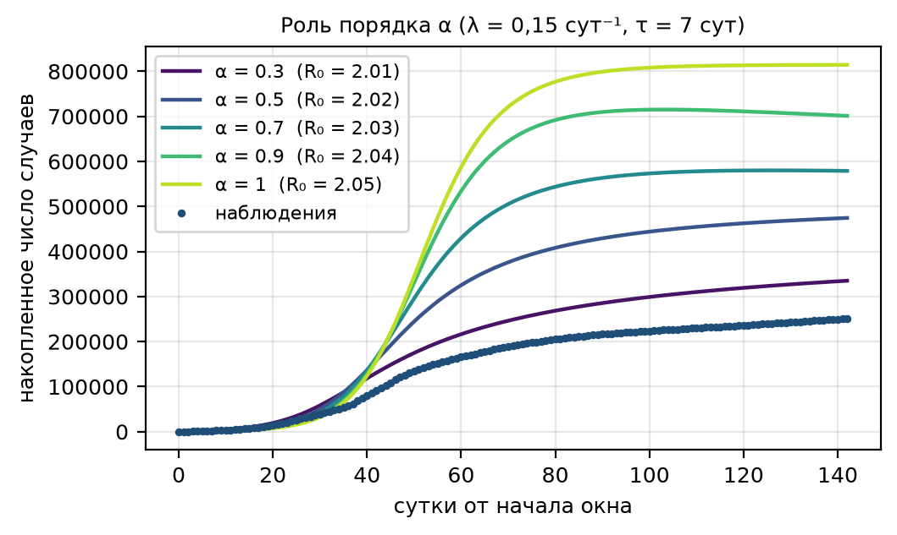
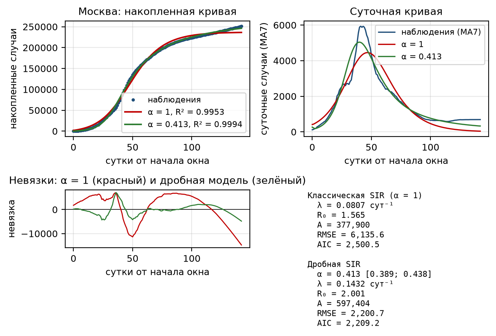
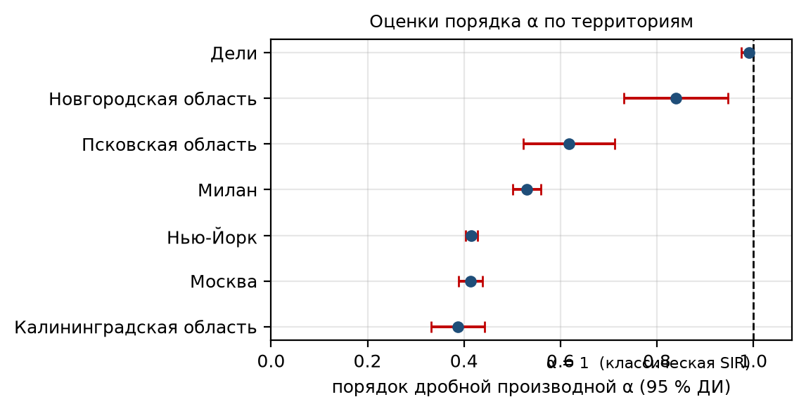

# Идентификация параметров волны заболеваемости с применением дифференциальных уравнений дробного порядка

**Аннотация.** Рассматривается идентификация параметров отдельной волны заболеваемости по
открытым данным о городах и регионах. Показано, что классическая SIR-модель с постоянными
коэффициентами в пределах эпидемиологически осмысленной области параметров систематически
занижает репродуктивное число и не воспроизводит наблюдаемую асимметрию волны (быстрый
подъём при медленном спаде). Предложено описывать волну SIR-моделью с производной Капуто
порядка α ∈ (0, 1], вносящей в динамику эффект памяти. Численная реализация основана на
схеме L1, корректность которой подтверждена сопоставлением с функцией Миттаг-Леффлера.
Идентификация проведена для семи территорий четырёх стран (Москва, Псковская,
Калининградская и Новгородская области, Нью-Йорк, Милан, Дели) по воспроизводимым открытым
наборам данных. Дробная модель значимо улучшает описание для пяти территорий из семи
(ΔAIC от 24 до 469, снижение RMSE до 78 %); оценки α лежат в диапазоне 0,387–0,990 и
устойчивы к вариации длительности инфекционного периода. Для Новгородской области и Дели
α статистически неотличим от единицы, то есть классическая модель там достаточна.

**Ключевые слова:** дробная производная Капуто; SIR-модель; идентификация параметров;
волна заболеваемости; функция Миттаг-Леффлера; схема L1; COVID-19.

## 1. Введение

Волна заболеваемости — характерная форма развития эпидемии: число новых случаев растёт,
достигает максимума и затем убывает. Для количественного описания волны традиционно
используются компартментные модели, прежде всего модель SIR [17, 18]. Однако при
идентификации параметров одиночной волны классическая SIR-модель с постоянными
коэффициентами сталкивается с принципиальной трудностью: спад волны в ней возможен лишь
за счёт истощения восприимчивой части популяции, тогда как реальное снижение заболеваемости
в первую очередь определяется изменением поведения и ограничительными мерами [19].
Как следствие, модель либо требует нереалистичной доли переболевших, либо не
воспроизводит наблюдаемую форму кривой.

Один из способов учесть немонотонный характер контактов, не вводя явно зависящие от
времени коэффициенты, — заменить обычную производную по времени дробной производной
порядка α < 1. Такая замена придаёт модели нелокальность: скорость изменения состояния
определяется всей предысторией процесса, а не только текущим моментом. Дробные
эпидемиологические модели рассматривались в работах [11–16]; при этом вопрос о том,
*насколько* порядок α улучшает именно задачу идентификации параметров отдельной волны и
при каких условиях классическая модель остаётся достаточной, изучен недостаточно.

Цель работы — сравнить оценки параметров волны, получаемые классической SIR-моделью и её
дробным аналогом с производной Капуто, на едином протоколе идентификации и на открытых
данных о нескольких территориях, и выяснить, в каких случаях добавление порядка α
оправдано.

Новизна работы состоит в следующем: (а) предложена параметризация дробной SIR-модели через
эпидемиологически интерпретируемые величины R₀ и λ, корректная при любом α и обеспечивающая
сопоставимость оценок между моделями и территориями; (б) проведён единый численный
эксперимент для семи территорий четырёх стран; (в) показано, что порядок α является
устойчивым дескриптором волны, а отказ от него статистически оправдан лишь для части
территорий.

## 2. Дробные производные Капуто и их физический смысл

**Определение.** Пусть y(t) — функция, заданная при t ≥ 0. Дробная производная Капуто
порядка α ∈ (0, 1) определяется как [1, 2]

  ᴰCα y(t) = (1/Γ(1−α)) ∫₀ᵗ (t − s)−α y′(s) ds,  (1)

где Γ(·) — гамма-функция. В отличие от производной Римана–Лиувилля, определение (1)
содержит производную обычного порядка под интегралом. Благодаря этому дробная производная
Капуто от постоянной равна нулю, что позволяет формулировать начальные задачи в привычном
виде и сохраняет физическую размерность: если y имеет размерность [y], а t — [t], то
ᴰCα y имеет размерность [y]·[t]−α [3, 5].

**Предельные случаи и память.** При α → 1 определение (1) переходит в обычную производную
y′(t), при α → 0 — в y(t) − y(0). Ядро (t − s)−α убывает степенным образом, то
есть влияние прошлого ослабевает медленно; говорят, что оператор обладает *памятью*.
Дробным аналогом экспоненты служит функция Миттаг-Леффлера

  Eα(z) = Σk≥0 zk / Γ(αk + 1),  (2)

которая является решением задачи ᴰCα y = −λy, y(0) = 1:
y(t) = Eα(−λtα) [2, 3]. При α = 1 функция (2) совпадает с
экспонентой. Именно функция (2) используется ниже для верификации численной схемы.

**Физический смысл α в эпидемиологии.** В компартментных моделях порядок α не является
биологической характеристикой возбудителя. Он описывает коллективное свойство популяции:
насколько отклик числа новых заражений запаздывает относительно текущей обстановки.
Чем меньше α, тем сильнее выражена инерция — длиннее «хвост» волны при той же начальной
скорости роста. В терминах теории случайных процессов α < 1 соответствует субдиффузионному
режиму блуждания, а в терминах теории управления — дробному порядку системы с распределённым
запаздыванием. Существенно, что малое α не означает «медленную эпидемию»: скорость
начального роста и порядок α — независимые характеристики.

**Связь параметров.** Для линейного приближения модели SIR в окрестности
эпидемического порога справедливо соотношение λα = β − γ, где λ — начальная
скорость экспоненциального роста (сут−1), β — скорость инфекции,
γ — скорость выбывания инфицированных. Обратно, λ = (β − γ)1/α, то есть при
уменьшении α та же начальная скорость роста достигается при меньшей разности β − γ.

## 3. Данные и объекты исследования

Использованы четыре открытых машиночитаемых набора данных, доступных для скачивания и
снабжённых фиксированными URL и контрольными суммами SHA-256 (загрузчик `code/fetch_data.js`,
манифест `data/manifest.json`). Состав территорий и окна наблюдения приведены в табл. 1.

Правило выбора окна: окно охватывает полностью наблюдаемые фазы роста и спада одной волны,
а суточная заболеваемость на его границах мала по сравнению с пиком. Для территорий России
источник содержит только период 26.03–17.10.2020, поэтому рассматривается первая волна;
для Дели данные начинаются 12.09.2020, поэтому взята первая полностью наблюдаемая волна —
волна «дельта» весны 2021 г. Наблюдаемой величиной служит накопленное внутри окна число
подтверждённых случаев; для контроля используется суточная кривая, сглаженная скользящим
средним за 7 суток.

Отметим неоднородность регистрации: число подтверждённых случаев составляет лишь долю
истинного числа заражений, поэтому в модель введена эффективная численность популяции A
(см. § 5).

**Таблица 1. Территории, источники данных и окна наблюдения**

  | Территория | Страна | Тип единицы | Население | Источник | Окно | n, сут |
  |---|---|---|---:|---|---|---:|
  | Москва | Россия | город | 12 678 079 | [25] | 2020-03-26 — 2020-08-15 | 143 |
  | Псковская область | Россия | регион | 626 115 | [25] | 2020-03-26 — 2020-08-15 | 143 |
  | Калининградская область | Россия | регион | 1 012 512 | [25] | 2020-03-26 — 2020-08-15 | 143 |
  | Новгородская область | Россия | регион | 596 508 | [25] | 2020-03-26 — 2020-08-15 | 143 |
  | Нью-Йорк | США | город | 8 336 817 | [23] | 2020-02-29 — 2020-07-31 | 154 |
  | Милан | Италия | провинция | 3 259 000 | [24] | 2020-02-25 — 2020-07-31 | 158 |
  | Дели | Индия | город | 19 800 000 | [26] | 2021-03-01 — 2021-07-31 | 136 |

## 4. Классическая модель и оценка параметров

В качестве базовой используется модель SIR:

  dS/dt = −βSI/A,  dI/dt = βSI/A − γI,  S(0) = A − I₀,  I(0) = I₀,  (3)

где S, I — численности восприимчивых и инфицированных, A — эффективная численность
популяции, I₀ — число инфицированных в начальный момент окна. Наблюдаемая величина —
накопленное число случаев C(t) = A − S(t).

Параметризация выбрана так, чтобы свободные параметры имели ясный эпидемиологический
смысл и были сопоставимы между моделями:

  λ — начальная скорость экспоненциального роста, сут−1;
  τ — характерная длительность инфекционного периода, сут;
  I₀ — начальное число инфицированных;
  A — эффективная численность популяции.

Скорости инфекции и выбывания восстанавливаются как γ = τ−1, β = γ + λ, откуда
R₀ = β/γ = 1 + λτ. Оценка выполнена методом наименьших квадратов по критерию

  RSS(θ) = Σj (Cмод(tj; θ) − Cнабл(tj))²,  (4)

минимизация — методом trust-region reflective [22] с ограничением параметров логистическим
преобразованием внутрь допустимой области и с многократным стартом (20 стартовых точек,
детерминированная сетка по λ и I₀); это необходимо из-за многомодальности критерия (4).
Доверительные интервалы получены линеаризацией по матрице Якоби. Область допустимых
значений: λ ∈ [0,02; 0,90] сут−1, τ = 7 сут (анализ чувствительности — в § 6),
I₀ ∈ [0,5; 10⁵], A ∈ [Cкон, min(10·Cкон; 12·Nнас)], где
Cкон — наблюдённое число случаев к концу окна; нижняя граница A отвечает
коэффициенту регистрации не выше 100 %, верхняя — не ниже 10 %.

Качество подгонки классической модели для Москвы показано на рис. 2. Модель
удовлетворительно описывает подъём, но систематически отклоняется на спаде: невязка
меняет знак и достигает 10⁴ случаев, что для волны с амплитудой 2,5·10⁵ составляет
несколько процентов. Причина состоит в том, что для поворота кривой при наблюдаемом уровне
накопленной заболеваемости классическая модель вынуждена выбирать малое R₀
(1,42–1,66 для всех территорий, табл. 2), а это плохо согласуется с наблюдаемой начальной
скоростью роста λ ≈ 0,06–0,21 сут−1.

## 5. Дробная модель и идентификация параметров

Дробный аналог системы (3) получается заменой обычных производных на производные Капуто:

  ᴰCαS = −βSI/A,  ᴰCαI = βSI/A − γI,  (5)

с теми же начальными условиями. При α = 1 система (5) переходит в (3), что обеспечивает
корректность сравнения.

**Параметризация.** В дробной модели величины β и γ имеют размерность сут−α и
потому напрямую несопоставимы ни между собой, ни с классической моделью. Поэтому система (5)
параметризуется теми же величинами λ и τ:

  γ = τ−α,  β = γ + λα,  откуда  R₀ = β/γ = 1 + (λτ)α.  (6)

Соотношение (6) при α = 1 совпадает с классическим R₀ = 1 + λτ, а при α < 1 показывает, что
то же самое значение R₀ достигается при меньшей начальной скорости роста. Такая
параметризация снимает вырожденность задачи: в исходных переменных (β, γ) целевая функция
имеет протяжённую овражную область, в которой β и γ меняются на порядки при почти неизменной
невязке.

**Численная схема.** Для дискретизации производной Капуто применена схема L1 [7–9]. На
равномерной сетке tn = nΔt:

  ᴰCαy(tn) ≈ (Δt−α/Γ(2−α)) Σk=0n−1 bk (yn−k − yn−k−1),
  bk = (k+1)1−α − k1−α,  b₀ = 1.  (7)

Явная схема на основе (7) имеет вид

  yn = yn−1 + Γ(2−α)Δtα f(yn−1) − Σk=1n−1 bk(yn−k − yn−k−1).  (8)

Шаг принят равным Δt = 0,1 сут, что обеспечивает устойчивость при рассматриваемых значениях
параметров. Вычислительная стоимость одного прохода составляет O(n²) из-за суммы истории;
при n ≤ 1,6·10³ это приемлемо, а сумма вычисляется как скалярное произведение с массивом
приращений.

**Верификация схемы.** Схема (8) проверена на задаче ᴰCαy = −λy,
y(0) = 1, имеющей точное решение (2). При α = 1/2, λ = 1, t = 1 точное значение
E1/2(−1) = e·erfc(1) = 0,4275835762; схема даёт 0,4267453 (n = 100),
0,4274983 (n = 1000) и 0,4275750 (n = 10 000), то есть ошибка убывает как O(Δt) с
наблюдаемым порядком 0,99–1,00. Дополнительно проведено сравнение при t = 5, α = 0,5 с
разложением (2) в ряд: расхождение 5,6·10−6. Отметим, что классическая оценка
порядка точности схемы L1 — O(Δt2−α) — относится к аппроксимации самого
оператора (7); наблюдаемый глобальный порядок оказывается близким к единице из-за слабой
особенности решения при t = 0. Независимая реализация на Julia (только стандартная
библиотека) воспроизводит те же числа с относительным расхождением ~10−12.

**Роль α.** На рис. 1 показано семейство решений системы (5) при фиксированных λ, τ, A и I₀
и разных α. При уменьшении α кривая теряет симметрию: подъём ускоряется, а спад
затягивается, что и наблюдается в реальных данных.

## 6. Результаты и сравнение

**Точность описания.** Оценки параметров для обеих моделей по всем семи территориям
приведены в табл. 2. Дробная модель улучшает описание на всех территориях, однако
статистическая значимость улучшения существенно различается.

**Таблица 2. Оценки параметров классической и дробной SIR-моделей** (τ = 7 сут)

  | Территория | Модель | α (95 % ДИ) | λ, сут⁻¹ | R₀ | A | RMSE | R² | AIC | ΔAIC |
  |---|---|---|---:|---:|---:|---:|---:|---:|---:|
  | Москва | классическая | 1 | 0,081 | 1,565 | 377 900 | 6 135,6 | 0,9953 | 2 500,5 | — |
  | Москва | дробная | 0,413 (0,389–0,438) | 0,143 | 2,001 | 597 404 | 2 200,7 | 0,9994 | 2 209,2 | +291,3 |
  | Псковская обл. | классическая | 1 | 0,072 | 1,506 | 6 879 | 60,2 | 0,9984 | 1 177,7 | — |
  | Псковская обл. | дробная | 0,618 (0,522–0,713) | 0,084 | 1,718 | 9 682 | 54,9 | 0,9986 | 1 153,8 | +23,9 |
  | Калининградская обл. | классическая | 1 | 0,060 | 1,419 | 5 618 | 56,0 | 0,9974 | 1 157,0 | — |
  | Калининградская обл. | дробная | 0,387 (0,331–0,442) | 0,091 | 1,839 | 9 419 | 34,6 | 0,9990 | 1 021,6 | +135,5 |
  | Новгородская обл. | классическая | 1 | 0,060 | 1,423 | 7 733 | 35,5 | 0,9994 | 1 027,0 | — |
  | Новгородская обл. | дробная | 0,839 (0,732–0,947) | 0,063 | 1,506 | 8 741 | 35,3 | 0,9994 | 1 027,1 | −0,0 |
  | Нью-Йорк | классическая | 1 | 0,095 | 1,663 | 313 102 | 6 230,0 | 0,9936 | 2 697,0 | — |
  | Нью-Йорк | дробная | 0,416 (0,403–0,428) | 0,188 | 2,122 | 483 966 | 1 351,5 | 0,9997 | 2 228,4 | +468,7 |
  | Милан | классическая | 1 | 0,075 | 1,522 | 40 262 | 521,1 | 0,9964 | 1 982,9 | — |
  | Милан | дробная | 0,530 (0,501–0,560) | 0,118 | 1,903 | 54 221 | 331,5 | 0,9986 | 1 841,9 | +140,9 |
  | Дели | классическая | 1 | 0,208 | 2,458 | 898 229 | 10 751,0 | 0,9990 | 2 530,9 | — |
  | Дели | дробная | 0,990 (0,975–1,000) | 0,207 | 2,444 | 912 422 | 10 686,1 | 0,9991 | 2 531,3 | −0,4 |

**Таблица 3. Сравнение качества подгонки**

  | Территория | Снижение RMSE, % | Вес Акаике: классическая / дробная |
  |---|---:|---|
  | Москва | 64,1 | 0,000 / 1,000 |
  | Псковская область | 8,7 | 0,000 / 1,000 |
  | Калининградская область | 38,2 | 0,000 / 1,000 |
  | Новгородская область | 0,7 | 0,506 / 0,494 |
  | Нью-Йорк | 78,3 | 0,000 / 1,000 |
  | Милан | 36,4 | 0,000 / 1,000 |
  | Дели | 0,6 | 0,544 / 0,456 |

Из табл. 2 и 3 следуют четыре основных результата.

*Во-первых*, оценка α значимо меньше единицы для пяти территорий из семи: Москва (0,413),
Нью-Йорк (0,416), Калининградская область (0,387), Милан (0,530) и Псковская область (0,618);
во всех случаях 95 %-е доверительные интервалы не содержат единицу (рис. 3). Для этих
территорий память является статистически необходимой компонентой модели.

*Во-вторых*, выигрыш в качестве описания значителен именно там, где волна наиболее выражена:
снижение RMSE составляет 78,3 % для Нью-Йорка, 64,1 % для Москвы, 38,2 % для Калининградской
области, 36,4 % для Милана. Разность AIC достигает 469 (Нью-Йорк) и 291 (Москва) в пользу
дробной модели, что отвечает весу Акаике, практически равному единице [20].

*В-третьих*, для Новгородской области (α = 0,839; ΔAIC = −0,05) и Дели (α = 0,990;
ΔAIC = −0,35) выигрыш лежит в пределах статистической погрешности, а веса Акаике близки к
0,5/0,5. Для волны «дельта» в Дели классическая модель оказывается достаточной: её форма
близка к экспоненциальному росту с последующим быстрым спадом, что и даёт α ≈ 1. Этот
результат принципиален: дробная модель не «выигрывает всегда», а подключается тогда, когда
в данных действительно присутствует инерция.

*В-четвёртых*, добавление порядка α систематически повышает оценку R₀: для Москвы
1,565 → 2,001, для Нью-Йорка 1,663 → 2,122, для Милана 1,522 → 1,903. Иными словами,
классическая модель, вынужденная объяснять спад истощением восприимчивых, занижает
репродуктивное число в 1,15–1,30 раза. Именно в этом состоит количественное выражение
систематической ошибки, качественно обсуждавшейся во введении.

**Устойчивость.** Длительность инфекционного периода τ не является предметом оценивания и
задана априорно (τ = 7 сут). Для проверки устойчивости результаты пересчитаны при τ = 5 и
τ = 10 сут. Оценки α меняются не более чем на 0,03: например, для Москвы 0,409 / 0,413 /
0,419, для Нью-Йорка 0,411 / 0,416 / 0,421, для Дели 0,998 / 0,990 / 0,981. Вывод о
присутствии памяти, таким образом, не зависит от выбора τ; значения R₀ при этом изменяются
в соответствии с соотношением (6) (для Москвы 1,873 / 2,001 / 2,162).

Дополнительно проверена устойчивость к выбору наблюдаемой величины: при переходе от
накопленной кривой к суточной сглаженной качественный вывод сохраняется, а оценки α
смещаются в сторону меньших значений — 0,438 (Москва), 0,430 (Нью-Йорк), 0,343 (Милан),
0,360 (Калининградская область), 0,501 (Псковская область), 0,706 (Новгородская область),
0,660 (Дели). Разность AIC в пользу дробной модели положительна для всех территорий — от
+1,2 (Новгородская область) до +205 (Нью-Йорк); при этом для Новгородской области выигрыш
остаётся в пределах шума.

## 7. Обсуждение и выводы

**Интерпретация α.** Полученные значения α группируются в двух областях: 0,39–0,62 для
первых волн 2020 г. в Москве, Нью-Йорке, Милане, Калининградской и Псковской областях и
0,84–0,99 для Новгородской области и волны «дельта» в Дели. Первая группа отвечает волнам,
спад которых был затяжным и определялся постепенным изменением поведения и ограничительными
мерами; вторая — волнам с быстрым «схлопыванием», форма которых близка к классической.
Таким образом, α можно рассматривать как количественную меру инерции популяционного отклика,
дополняющую привычные λ и R₀. Важно подчеркнуть, что α не является свойством возбудителя.

**Ограничения.** Использованы данные о подтверждённых случаях, зависящие от охвата
тестирования; коэффициент регистрации не оценивается, а поглощается эффективной численностью
A, границы которой заданы априорно. Эффективная численность A и скорость роста λ в
классической модели частично компенсируют друг друга, поэтому доверительные интервалы
отдельных параметров следует считать оптимистичными. Рассматривается изолированная волна без
учёта повторных заражений, вакцинации и заноса инфекции извне; для волны «дельта» в Дели
последнее обстоятельство, по-видимому, существенно. Наконец, доверительные интервалы
построены линеаризацией; для параметров на границе области допустимых значений они
недооценивают неопределённость, и здесь уместен профильный анализ правдоподобия [22] или
бутстрап остатков [21].

**Практическая значимость.** Процедура идентификации сводится к минимизации (4) по четырём
параметрам и реализуется на стандартной библиотеке; полный расчёт для одной территории
занимает секунды. Оценка α даёт дополнительный, устойчивый дескриптор волны, позволяющий
содержательно сравнивать территории и периоды, а также прогнозировать затяжной спад там,
где α значимо меньше единицы.

**Выводы.**

1. Замена обычной производной на производную Капуто порядка α в SIR-модели позволяет описать
   форму волны заболеваемости, недоступную классической модели с постоянными коэффициентами:
   снижение RMSE достигает 78 % при добавлении всего одного параметра.

2. Оценка α значимо меньше единицы для пяти из семи рассмотренных территорий
   (0,387 ≤ α ≤ 0,618); для Новгородской области и Дели α статистически неотличим от
   единицы, то есть классическая модель там достаточна.

3. Классическая SIR-модель систематически занижает репродуктивное число — от 1,15 до
   1,30 раза для рассмотренных территорий, — компенсируя этим неспособность воспроизвести
   асимметрию волны.

4. Параметризация дробной модели через R₀ = 1 + (λτ)α устраняет вырожденность
   задачи идентификации и обеспечивает сопоставимость оценок между моделями, территориями и
   значениями α.

5. Оценки α устойчивы к вариации априорно задаваемой длительности инфекционного периода
   (изменение не более 0,03 при τ от 5 до 10 суток), а численная схема L1 подтверждена
   сопоставлением с аналитическим решением через функцию Миттаг-Леффлера.

**Доступность данных и кода.** Численный эксперимент воспроизводится скриптами `code/python`
(Python 3.12, `uv`) и `code/julia` (Julia 1.12, Pluto-блокнот); исходные данные загружаются
скриптом `code/fetch_data.js` и зафиксированы контрольными суммами SHA-256 в
`data/manifest.json`. Обе реализации дают совпадающие результаты с относительным
расхождением ~10−12. Список литературы приведён отдельным файлом.
